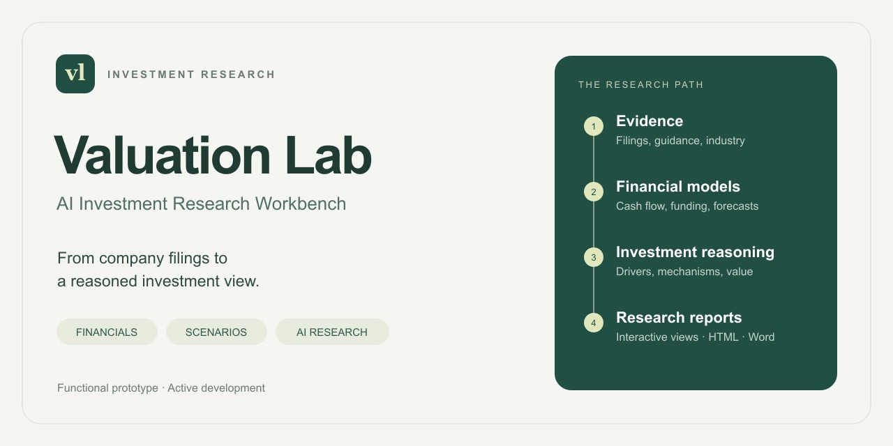
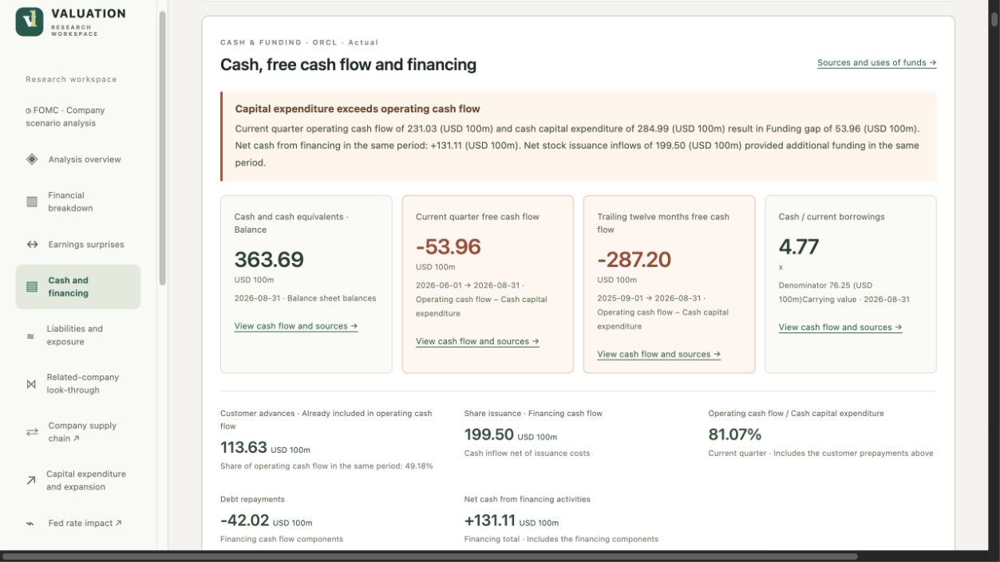
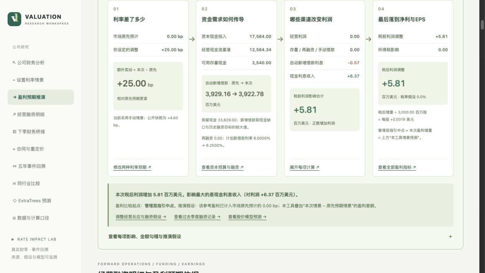
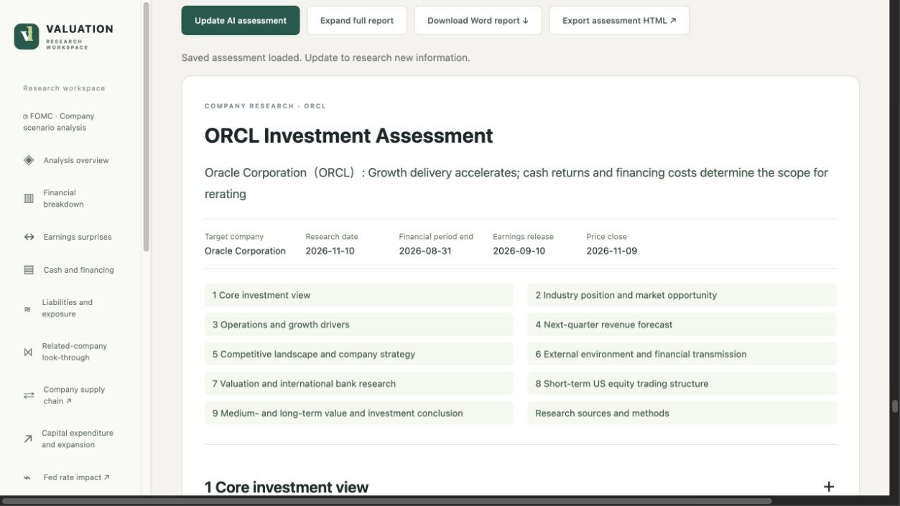
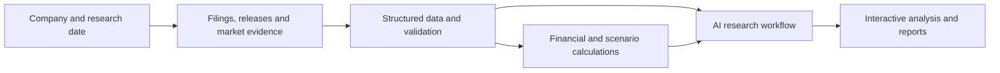

# Valuation Lab

**AI Investment Research Workbench**

From company filings to a reasoned investment view. Valuation Lab brings financial analysis, debt and funding models, monetary-policy scenarios, and structured AI research into one local web application for U.S.-listed non-financial companies.

**Functional prototype · Active development**  
[中文介绍](README.zh-CN.md) · [AI research methodology](docs/ai-research.md) · [Development roadmap](docs/roadmap.md)

## The investment question

Revenue growth is only part of the story. An investor also needs to understand what drives that growth, how much cash expansion consumes, when funding must be renewed, and which assumptions are already reflected in expectations.

Valuation Lab connects those questions. It follows the path from reported financials and contractual obligations to operating forecasts, financing requirements and valuation, keeping the underlying periods, definitions and evidence attached to the analysis.

## Product walkthrough

### 1. Read earnings and cash together

Compare matching reporting periods, reconcile operating cash flow with capital expenditure, and distinguish cash balances from cash generation. The financing view explains how borrowing, equity issuance and customer prepayments contribute to funding.

### 2. Trace a rate scenario into company earnings

Enter an expected policy-rate change in basis points. The application follows existing debt repricing, refinancing, planned capital expenditure, incremental borrowing and cash interest income into next-quarter profit and EPS. Historical event windows and an ExtraTrees model provide a separate view of share-price responses.

*Archived scenario example: a +25 bp policy change versus a 0 bp market-expectation baseline, with financing and earnings effects calculated from that run's assumptions.*

### 3. Build an investment report with an explicit research process

The AI assessment combines industry economics, growth attribution, competitive structure, financial quality, valuation and U.S. market technicals. Next-quarter revenue is estimated through both a top-down industry path and a bottom-up operating path, then compared with management guidance.

**[Explore the AI research workflow →](docs/ai-research.md)**

*These are selected views from the working development prototype. Company figures and scenario outputs belong to their saved research snapshots; captions and the interface retain their reporting context. English and Chinese interfaces are supported; the captures show the Chinese interface.*

## Research capabilities

| Module | Questions it helps answer |
|---|---|
| Financial statements and earnings expectations | How have revenue, margins and cash flow changed? How did reported results compare with dated expectations? |
| Debt, funding and valuation | Which obligations reprice or mature, how is expansion funded, and how do financing assumptions change value? |
| FOMC company analysis | How do the policy statement and the Chair's remarks connect to this company's operating plans and funding needs? |
| AI company assessment | Is growth driven by the industry, the company's competitive position, or operating execution? What supports the next-quarter forecast? |
| Ownership and supply-chain relationships | Which investments, loans, guarantees, suppliers and customers connect to the company? |
| Trading review | How do realized results, transaction costs, cash flows and position decisions explain account performance? |

## How the application works

**AI research** retrieves evidence and develops company-specific explanations. **Python calculations** produce financial bridges, forecast totals and market statistics. **Validation** checks periods, units, references and reconciliation. A shared report structure supplies the website, HTML export and Word document.

The prototype uses a Python backend, HTML/CSS/JavaScript interfaces, OpenAI API research with structured outputs, and scikit-learn for the ExtraTrees event-response model. Local snapshots preserve the basis of each research run. The user supplies their own API credentials; Bloomberg-assisted supply-chain retrieval uses the user's own terminal access.

## Current development

This repository is the public product showcase: project documentation, research methodology and selected interface captures. The working application is being refined for a portable release.

The next milestones are standard installation, a sample-data experience, reproducible examples and packaging the company-research workflow as a reusable Agent Skill within the project. The [roadmap](docs/roadmap.md) distinguishes implemented functionality from upcoming distribution work.

Designed and developed by [Ethan Chen](https://github.com/zhanfengchen1996-hash).
