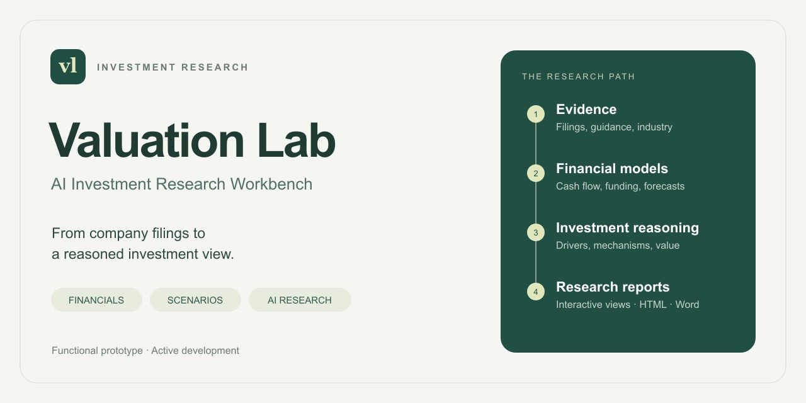
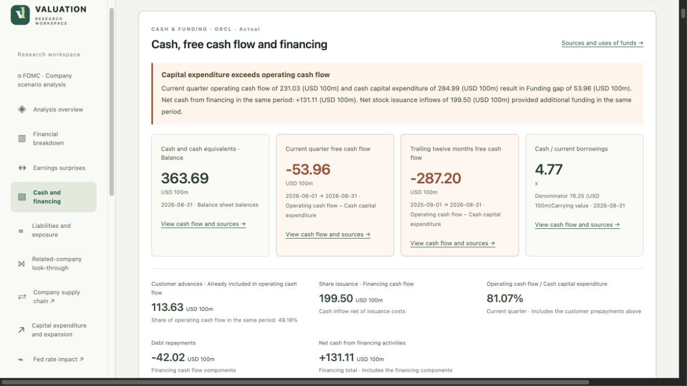
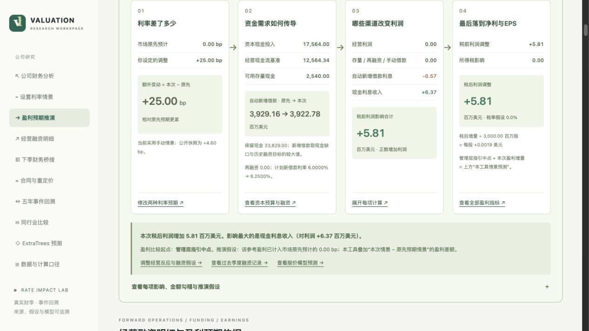
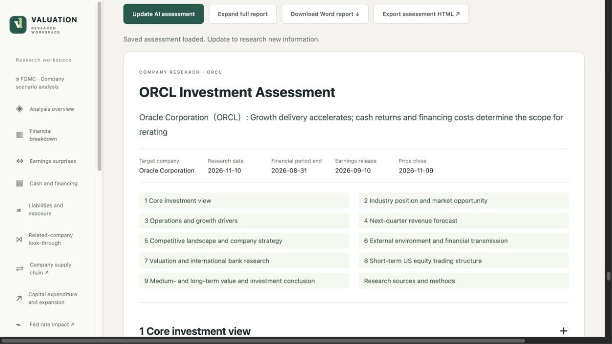

# Valuation Lab

**AI 投资研究工作台**

从公司财报到有依据的投资判断。Valuation Lab 将财务分析、债务与融资模型、货币政策情景和结构化 AI 研究组织在一个本地网页应用中，面向美股非金融公司的投资研究。

**可运行原型 · 持续开发中**  
[English](README.md) · [AI 研究方法](docs/ai-research.md#中文说明) · [开发路线图](docs/roadmap.md#中文路线图)

## 产品关注的问题

收入增长需要进一步解释：增长来自行业扩张、竞争优势还是公司自身执行？扩建会消耗多少现金？债务何时到期、如何计息？未来业绩与市场已经形成的预期相差多少？

Valuation Lab 将这些问题串联起来，从财务实绩和合同义务出发，推演经营收入、融资需求及估值，并保留对应的期间、口径和证据。

## 三个核心界面

### 财务表现、现金流与资金来源

同口径比较财务期间，将经营现金流与资本支出对照，解释现金存量、现金创造和外部融资之间的关系。

### 利率变化如何传导到盈利

输入预期加息或降息的 bp 幅度，连接存量债务重定价、到期再融资、资本开支计划、新增借款及现金利息收入，形成下一季度利润与 EPS 的调整路径。历史事件回溯与 ExtraTrees 模型另行展示股价响应。

*已保存情景示例：政策变动 +25 bp，对比市场原先预期 0 bp；融资与盈利影响按该次运行的假设计算。*

### AI 公司投资评估

研究覆盖行业经济性、收入增长归因、竞争结构、财务质量、估值及美股短期交易结构。下一季度收入同时采用自上而下与自下而上两条预测路径，并与管理层指引进行同口径比较。

**[查看 AI 研究方法与流程 →](docs/ai-research.md#中文说明)**

*截图来自正在开发的实际产品。公司数值和情景结果对应各自保存的研究快照，图内保留财报期间及相关口径。产品支持中英文切换，本页展示中文界面。*

## 功能模块

| 模块 | 主要分析内容 |
|---|---|
| 财务与业绩预期 | 收入、利润率、现金流的同期比较；最近两期财报实际值与有日期的市场预期对照 |
| 债务、融资与估值 | 固定与浮动计息、到期日历、融资需求、扩建预算及估值敏感性 |
| FOMC 公司推演 | 会议声明和主席发言与公司经营、资本投入和融资安排之间的传导 |
| AI 投资评估 | 行业分析、公司竞争策略、收入预测、投行观点比较及短期与长期判断 |
| 关联公司与供应链 | 股权、借款、担保等关系，以及供应商与客户的可视化查询 |
| 交易复盘 | 已实现收益、交易成本、资金流动、头寸表现及执行记录 |

## 实现方式

AI 负责检索证据并形成公司分析；Python 负责财务桥接、收入预测汇总和市场统计；校验程序核对期间、单位、来源引用与数字勾稽。网页、HTML 导出和 Word 报告使用共同的报告结构。

产品采用 Python 后台、HTML/CSS/JavaScript 界面、OpenAI API 结构化研究及 scikit-learn ExtraTrees 模型。研究快照在本地保存，API 由使用者自行配置，Bloomberg 供应链查询使用其自己的终端权限。

## 当前进展

本仓库用于展示产品、研究方法及实际界面。应用正在完善独立安装、示例数据体验和可复现案例，后续将公司研究流程封装为项目内可复用的 Agent Skill。已实现功能与下一阶段工作见[路线图](docs/roadmap.md#中文路线图)。

设计与开发：[Ethan Chen](https://github.com/zhanfengchen1996-hash)。
