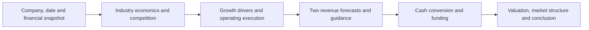
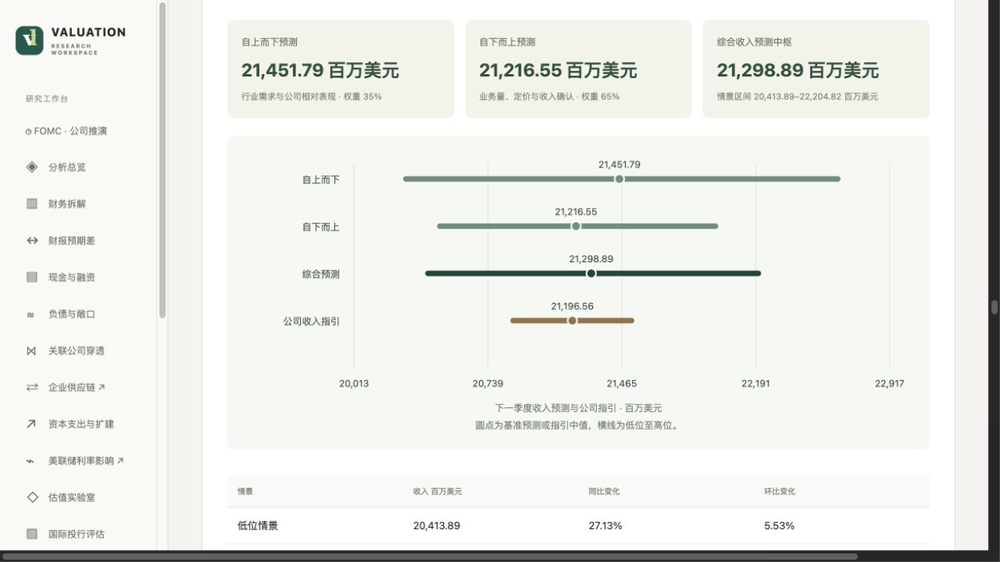

# AI Investment Research Workflow

**The company-research methodology inside Valuation Lab.**  
[Product overview](../README.md) · [中文说明](#中文说明) · [Roadmap](roadmap.md)

The research process connects a company's industry position to its operating results, funding needs and valuation. Its central task is to explain how a business fact changes the investor's financial picture.

The workflow is implemented inside the application. The separate [Equity Research Skill](https://github.com/zhanfengchen1996-hash/equity-research-skill) repository now provides English research instructions, analytical references and editable Markdown and Word report templates under MIT. The host agent supplies data access, calculations and document export for this instruction-based release.

## From evidence to an investment view

Every stage follows a consistent reasoning pattern: **judgment → evidence → economic mechanism → financial consequence**. The consequence may be a change in revenue, margin, working capital, capital expenditure, interest expense, dilution or the valuation multiple.

## 1. Define the economic market

Third-party industry classification provides the starting point. The analysis then identifies the relevant products, customers and geography, and studies market growth, supply-demand conditions, profitability, capacity and customer concentration. Peer comparisons retain their reporting periods and accounting definitions.

The research separates broad demand growth from company-specific execution. Pricing, volume, product mix, capacity delivery, acquisitions and currency effects are examined individually. A difference between company growth and an industry benchmark is described as relative performance; market-share conclusions use evidence about the relevant market and company sales.

## 2. Connect competitive position to financial outcomes

Porter's Five Forces organizes competitive pressure from existing firms, entrants, substitutes, suppliers and customers. PESTLE connects political, economic, social, technological, legal and environmental developments to the company's economics. Each material factor is explained through an operating or financial channel.

Company strategy is assessed through cost leadership, differentiation, focus or a combination. Evidence may include customer switching costs, production economics, distribution, contractual commitments and the capital required to sustain the strategy. The analysis asks how those advantages translate into returns on capital and cash available to shareholders.

## 3. Forecast the next fiscal quarter through two paths

| Path | Starting point | Operating logic |
|---|---|---|
| Top-down | Industry demand, spending or activity and a matched company baseline | Relate the external market to the company's exposure, positioning and expected conversion into revenue. |
| Bottom-up | Business lines, recent reported activity and company operating plans | Estimate volume, pricing, utilization, capacity ramp-up or contract conversion for each relevant business. |
| Management guidance | The latest dated revenue and operating guidance | Compare the same fiscal period, business scope and currency basis; explain how guidance informed the assumptions. |

Both models estimate the same company's consolidated quarterly revenue. Their results are reconciled through explicit weights and a written explanation. The application calculates totals, growth rates and differences from guidance. Low, base and high operating assumptions describe the forecast range.

For a capacity-intensive business, this means connecting industry demand to usable capacity and billable activity. An expansion plan enters the forecast according to delivery and revenue-recognition timing. The analysis explains how cash expenditure may precede reported revenue and how financing costs affect the value of that growth.

*Oracle assessment example from the saved 10 November 2026 research snapshot. The chart shows the application's forecast paths, combined estimate and management-guidance comparison.*

## 4. Translate growth into funding and valuation

The report connects earnings to operating cash flow, capital expenditure, debt maturities and financing commitments. It considers the effect of new borrowing, interest expense and potential dilution on shareholder outcomes.

Dated investment-bank views provide an external comparison. The report identifies their central assumptions and develops its own reasoning about operating performance, financing and valuation. Source records distinguish original institutional material from public reporting of those views.

Long-term analysis focuses on competitive durability and cash returns. Short-term analysis uses U.S. market measures such as relative performance versus the market and sector, trend, momentum, realized volatility, ATR, relative volume and dollar trading activity. The separate rate-event model uses ExtraTrees with chronological, policy-event-grouped validation.

## 5. Produce one coherent report

The English Skill opens with an executive summary and develops nine connected chapters:

1. Business and Products
2. Industry and Market Outlook
3. Competition and Competitive Advantage
4. Financial Performance and Cash Flow
5. Next Quarter Revenue Forecast
6. Economic and Policy Environment
7. Valuation and Investment Bank Views
8. Share Price Trends and Near Term View
9. Long Term Outlook and Investment Conclusion

Evidence and methods are collected in an appendix. Shared report content supports the interactive website, standalone HTML and Word download.

## Engineering the research process

| Responsibility | Implementation approach |
|---|---|
| Evidence acquisition | Search issuer filings, earnings releases, guidance and dated public research; retain source records. |
| Research reasoning | Use structured AI outputs for company-specific analysis and forecast assumptions. |
| Numerical work | Calculate forecast totals, financial bridges, statistics and sensitivities in Python. |
| Consistency | Validate dates, units, source references, model weights and financial reconciliation. |
| Presentation | Render one report structure into the website and downloadable documents. |

The standalone Skill defines its invocation, input requirements, host-tool dependencies and report structure. Its first release focuses on the research method and English templates. Calculation scripts, automated export and worked company reports can be developed as separate extensions.

---

## 中文说明

**这是 Valuation Lab 内部的公司研究方法。** 独立的 [Equity Research Skill](https://github.com/zhanfengchen1996-hash/equity-research-skill) 已按 MIT 许可证发布英文研究指令、方法说明及 Markdown、Word 报告模板。数据访问、计算与导出由使用者的智能体环境提供。

研究路线为：**公司与研究时点 → 行业经济性与竞争 → 增长来源与经营执行 → 两条收入预测路径及指引 → 现金转换与融资 → 估值、市场结构与投资结论。**

每个小节连接判断、证据、经济机制和财务后果。行业分类、五力和 PESTLE 为分析提供结构，具体论证落实到收入、利润率、资本投入、融资成本、每股收益或估值倍数。

### 收入预测如何形成

自上而下路径从行业需求、支出和活动规模出发，结合公司业务暴露和竞争位置，解释外部需求如何转为收入。自下而上路径从业务线、最近一期经营实绩和公司计划出发，估算销量、价格、产能利用、项目爬坡及合同兑现。

两条路径对应同一财季的合并收入，通过明确权重和经济理由形成综合预测。管理层指引按期间、业务范围和币种口径对照；程序计算预测金额、同比与环比，以及相对指引的差额。上方 Oracle 截图展示 2026 年 11 月 10 日保存的研究结果及指引比较。

### 从公司增长走向投资判断

竞争策略分析解释公司的优势如何影响资本回报；现金流和融资分析连接资本支出、债务期限、新增利息及股权摊薄；有日期的投行观点提供外部比较。长期判断关注竞争优势与现金回报，短期分析使用美股相对收益、趋势、动量、波动和成交活跃度等指标。

英文 Skill 先提供执行摘要，再按九章展开：业务与产品、行业市场、竞争优势、财务与现金流、下一季度收入预测、经济与政策、估值与投行观点、短期股价趋势、长期展望与投资结论。资料与方法集中列入附录。

### 方法与软件如何结合

应用内由 AI 获取证据并形成研究论证，Python 完成数值计算，校验程序保持日期、单位、来源与财务逻辑一致。网页、HTML 和 Word 使用同一份报告结构。独立 Skill 已明确输入、工具依赖和输出格式，第一版聚焦英文研究方法与模板。

[返回产品介绍](../README.zh-CN.md)
